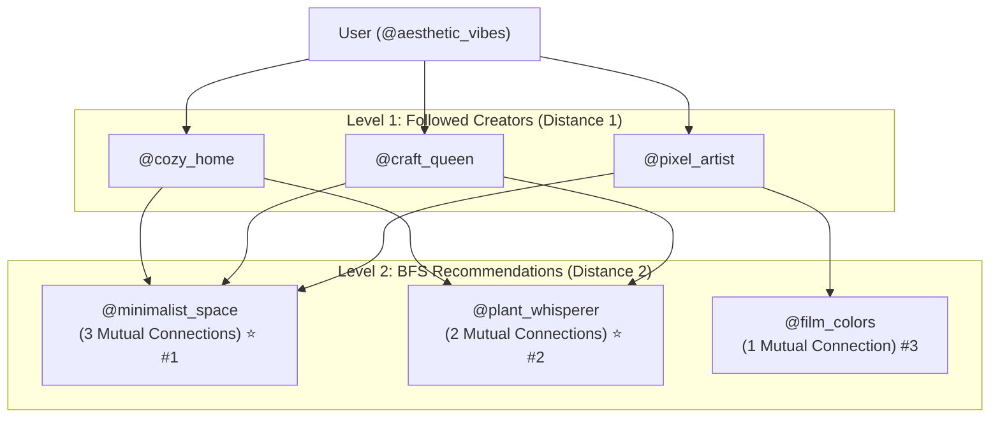

# Pixora Social Graph Engine 📌

A high-performance C++ Directed Graph data structure modeling the social network for **Pixora** (a Pinterest-like image and visual discovery platform).

Designed for the First Year B.Tech Data Structures project, implementing core social primitives and personalized recommendation algorithms.

---

## 🌟 Features Implemented

| Requirement | Method | Complexity | Description |
| :--- | :--- | :--- | :--- |
| **Follow** | `follow(follower, followee)` | $O(1)$ avg | Adds directed edge `follower -> followee`. Prevents self-follows and duplicates. |
| **Unfollow** | `unfollow(follower, followee)` | $O(1)$ avg | Removes directed edge `follower -> followee`. |
| **Followers** | `followers(user)` | $O(1) + O(k)$ | Returns list of accounts following `user` (incoming edges). |
| **Following** | `following(user)` | $O(1) + O(m)$ | Returns list of accounts `user` follows (outgoing edges). |
| **Mutual** | `mutual(userA, userB)` | $O(\min(d_A, d_B))$ | Finds creators that both users follow (intersection of outgoing follow sets). |
| **Mutuals Status** | `isMutualFollow(userA, userB)` | $O(1)$ | Checks if two users follow each other bidirectionally. |
| **BFS Suggestions** | `bfsSuggestions(user, limit, maxDepth)` | $O(V + E)$ | Breadth-First Search multi-hop discovery ("Friends of Friends"), ranked by mutual connection overlap and graph distance. |

---

## 🏗️ Architecture & Graph Representation

The graph is represented using dual hash-indexed adjacency lists with `std::unordered_map` and `std::unordered_set`:

```text
               Pixora Social Graph
               
  [Incoming Edges]                         [Outgoing Edges]
   followersMap                              followingMap
 (Who follows you)                         (Who you follow)
        │                                         │
        ▼                                         ▼
   O(1) Lookup                               O(1) Lookup
```

### Why Dual Adjacency Lists?
- In a naive directed graph, finding followers requires scanning every vertex's outgoing list ($O(V + E)$).
- By maintaining both `followingMap` and `followersMap`, both **followers** and **following** queries execute in **$O(1)$** lookup time.

---

## 🔍 BFS Recommendation Algorithm ("Suggested for You")

The `bfsSuggestions` algorithm mirrors the recommendation engines of Pinterest and Instagram:



### Recommendation Ranking Policy:
1. **Mutual Connection Overlap**: Candidates with more connections in common with your followed creators rank highest.
2. **BFS Distance**: Closer hops (e.g. distance 2: "friends of friends") take priority over farther hops (e.g. distance 3).
3. **Global Popularity**: Ties broken by total follower count.
4. **Safety Filter**: Recommender never suggests the user themselves or creators they already follow.

---

## 📁 Project Structure

```
DATA STRUCTURE/
├── include/
│   └── Graph.h             # Header declarations and Suggestion struct
├── src/
│   ├── Graph.cpp           # Graph method implementations
│   └── main.cpp            # Interactive CLI demonstration
├── tests/
│   └── test_graph.cpp      # Unit test suite
├── Makefile                # Build targets
└── README.md               # Documentation
```

---

## 🚀 Building & Running

### 1. Run Unit Tests
```bash
make test
```

### 2. Build and Launch Interactive CLI
```bash
make run
```

### 3. Clean Build Artifacts
```bash
make clean
```

---

## 💻 Code Example for Team Integration

```cpp
#include "Graph.h"
#include <iostream>

int main() {
    pixora::Graph g;

    // 1. Follow users
    g.follow("aesthetic_vibes", "craft_queen");
    g.follow("craft_queen", "aesthetic_vibes");
    g.follow("aesthetic_vibes", "pixel_artist");
    g.follow("pixel_artist", "film_colors");

    // 2. Check followers & following
    for (const auto& creator : g.following("aesthetic_vibes")) {
        std::cout << "Following: @" << creator << "\n";
    }

    // 3. Check if mutual followers
    if (g.isMutualFollow("aesthetic_vibes", "craft_queen")) {
        std::cout << "They follow each other!\n";
    }

    // 4. Get BFS-based 'Suggested for You'
    auto suggestions = g.bfsSuggestions("aesthetic_vibes", 5, 2);
    for (const auto& s : suggestions) {
        std::cout << "Recommended: @" << s.username 
                  << " (Mutuals: " << s.mutualConnectionsCount << ")\n";
    }

    return 0;
}
```
